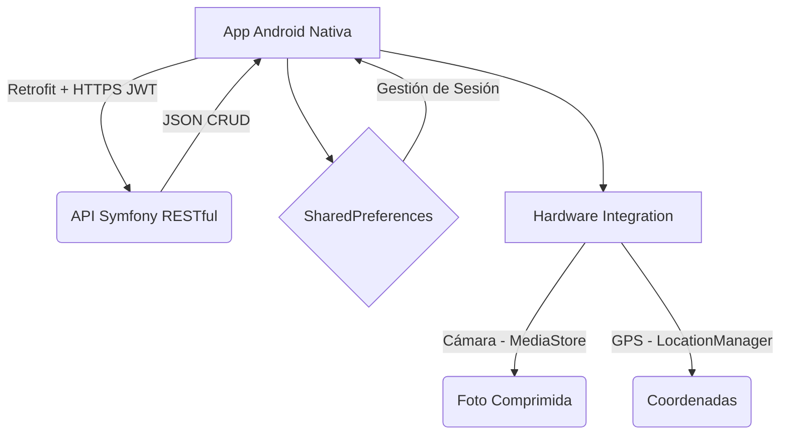

# Documentación Técnica y de Usuario: JuegAlmi (Android Nativo)

## 1. Introducción
La aplicación **JuegAlmi** es un cliente nativo para Android desarrollado en **Java y XML**. Su objetivo principal es ofrecer una tienda virtual para la compra de dispositivos, alquiler de videojuegos y consolas, y un servicio técnico (soporte) para pedir reparaciones.

Esta app ha sido desarrollada para cumplir con las especificaciones del **Reto JuegAlmi (DAM 2)**, garantizando que el diseño en Android Nativo replica la apariencia de la aplicación Híbrida (Ionic) desarrollada paralelamente, incluyendo la validación de persistencia CRUD contra una base de datos central.

Toda la aplicación actúa como cliente de una **API RESTful desarrollada en Symfony**, ubicada en `https://juegalmi-shop.duckdns.org/api/`.

---

## 2. Arquitectura y Tecnologías Clave

> [!NOTE]
> La aplicación sigue un patrón basado en una **Activity principal (`MainActivity`)** que actúa como contenedor de múltiples **Fragments** para facilitar la navegación fluida sin recargar la pantalla completa.

### Stack Tecnológico e Implementación de Resultados de Aprendizaje (RA)
*   **Acceso a Datos (RA1, RA2, RA3, RA6):**
    *   La comunicación con la BBDD se realiza a través del servicio web **RESTFul** (métodos `GET`, `POST`, `PUT`, `DELETE`).
    *   La persistencia y el consumo de la API se realizan garantizando la seguridad mediante **Tokens JWT**.
*   **Desarrollo de Interfaces (RA1-RA8):**
    *   **UI/UX:** XML utilizando los componentes nativos avanzados `RecyclerView` y `MaterialCardView` de *Material Design 3*.
    *   El diseño es adaptativo y el aspecto gráfico es **exactamente el mismo** que la app en Ionic, con una paleta de colores oscuros propia, libre de errores y fácil de usar.
*   **Programación de Dispositivos Móviles (RA1, RA2, RA3):**
    *   **Hardware:** Se ha integrado correctamente el uso de la **Cámara de fotos** y la **Geolocalización (GPS)**.
    *   Toda la carga de datos del catálogo (ventas y alquileres) se procesa de forma **asíncrona** y controlando sesiones de usuario localmente (`SharedPreferences`).
*   **Servicios y Procesos (RA1, RA2):**
    *   **Librería Asíncrona Avanzada:** En lugar de utilizar Volley, el proyecto apuesta por la eficiencia utilizando la arquitectura de **Retrofit 2** y **Gson** para la separación entre la Vista y los Datos, y para garantizar que la carga progresiva no entorpezca al usuario.

---

## 3. Módulos y Flujos de Trabajo

### 3.1. Autenticación (Login)
*   **Flujo:** El usuario introduce su correo (o *username*) y contraseña. Si la API devuelve un código 200, se extrae el token JWT y los datos del usuario (`nombre` y `email`).
*   **Persistencia:** Estos datos se guardan en `SharedPreferences`.
*   **Interceptores:** El `RetrofitClient` cuenta con un `Interceptor` de red. Por cada petición que la app hace al servidor, este interceptor adjunta automáticamente la cabecera `Authorization: Bearer <token>` de forma transparente.

### 3.2. Navegación Principal
Controlada por `MainActivity`, incluye dos menús para simular el aspecto de Google Play:
1.  **Bottom Navigation (Abajo):** Para acceso rápido al catálogo (Dispositivos, Videojuegos, Consolas) y Soporte.
2.  **Navigation Drawer (Lateral):** Para acceder al perfil (Historia, Galería, Servicios de la Tienda), a "Mis operaciones" y cerrar sesión.

### 3.3. Catálogo (Compras y Alquileres)
El `MobilesFragment` es dinámico. Según la pestaña seleccionada, interroga a un endpoint distinto (`/productos/dispositivos`, `/videojuegos` o `/consolas`).
*   **Comprar:** Al hacer clic, se lee el **GPS del dispositivo** y se envía una petición `POST /operaciones/comprar` con la ubicación actual y el ID del producto (cantidad = 1).
*   **Alquilar (Videojuegos y Consolas):** Muestra un cuadro de diálogo nativo pidiendo "Fecha Inicio" y "Fecha Fin" mediante `DatePickerDialog`. Se validan las fechas y se manda un `POST /operaciones/alquilar` con las fechas y la latitud/longitud.

### 3.4. Soporte y Reparaciones (`SupportFragment`)
Es el módulo más complejo, dividido internamente en 3 sub-vistas (controladas por un `TabLayout`):

1.  **Mis Aparatos:** Descarga el inventario del usuario (`GET /soporte/dispositivos`). Si quiere añadir uno, descarga la lista de marcas y departamentos, y envía el nuevo modelo por `POST`.
2.  **Pedir Reparación:**
    *   El usuario elige un aparato de su lista.
    *   Elige una tienda (cruzando los datos de los departamentos).
    *   Escribe una descripción.
    *   **Cámara:** Puede pulsar "Hacer foto". Se lanza un `Intent` nativo de cámara. La foto capturada (`Bitmap`) se comprime al 65% (para no exceder los 5MB de la API), se transforma a un string `Base64` y se adjunta a la carga útil (Payload) del JSON.
    *   Se envía un `POST /soporte/solicitudes`.
3.  **Mis Solicitudes:** Muestra las reparaciones en curso.
    *   **Editar:** Si la solicitud está "pendiente", permite editar la descripción enviando un `PUT`.
    *   **Cancelar:** Permite lanzar un `DELETE` a la API tras un cuadro de confirmación.

> [!IMPORTANT]
> **Gestión del GPS:** Al realizar compras, alquileres o pedir soporte, la clase `LocationHelper` verifica si hay permisos. Si los hay, inyecta latitud y longitud. Si el usuario deniega el permiso, inyecta `0.0, 0.0` para que la API no rechace la solicitud por campos nulos.

### 3.5. Mis Operaciones (Historial)
Muestra un `RecyclerView` con un diseño de `MaterialCardView` unificando todos los recibos del usuario:
*   Compras (detalles de cada producto y total pagado).
*   Alquileres.
*   Reparaciones.
La API lo devuelve todo en el endpoint `GET /operaciones/mis-operaciones` ordenado por fecha, y la aplicación renderiza dinámicamente campos como el "Motivo de rechazo" si existe.

---

## 4. Cumplimiento con Digitalización y Sostenibilidad

### 4.1. Digitalización Aplicada
*   **Seguridad Cloud:** Las peticiones desde la aplicación móvil están securizadas mediante **HTTPS** y la API (albergada en Cloud / DuckDNS) exige un **Token JWT** cifrado para operar.
*   **Uso de IA:** El desarrollo del código nativo de la aplicación, el escrutinio de errores de interfaz y la adaptación del diseño se han potenciado apoyándose en un agente IA especializado en desarrollo Android para mejorar la globalidad y el rendimiento del proyecto.

### 4.2. Sostenibilidad Aplicada
*   **Ahorro Computacional:** La elección de **Retrofit 2** asíncrono reduce el consumo del microprocesador local en el dispositivo de forma pasiva. La compresión automatizada de la cámara (reduciendo el Bitmap capturado antes de enviarlo por base64) ahorra ancho de banda, memoria RAM y reduce la huella de carbono digital generada por cada transacción del usuario.
*   **Economía Circular (Hardware):** Fomentar que el cliente tenga un portal de "Mis Reparaciones" directo en el bolsillo impulsa el ciclo de reparación frente a la compra de nuevos aparatos, atacando directamente la obsolescencia programada y minimizando los problemas ambientales derivados de los residuos electrónicos.

---

## 5. Estilos y Theming (Diseño de Referencia)
Se ha replicado el sistema de diseño oscuro exacto de la versión Híbrida (Ionic) para ofrecer la misma experiencia al usuario independientemente de la plataforma, como exige el hito de diseño:
*   Fondo general: `#0A0F22`
*   Tarjetas e Inputs: `#151E3A`
*   Color Primario (Botones y destacados): Naranja `#FF5A36`
*   Acentos (Precios y selecciones): Amarillo `#FFC53D`

Todo el mapeo de colores está centralizado en el archivo nativo `res/values/colors.xml` y se hace uso intensivo de `RecyclerView` y `MaterialCardView`, lo que permite un renderizado de UI muy rápido y eficiente a 60 fps.